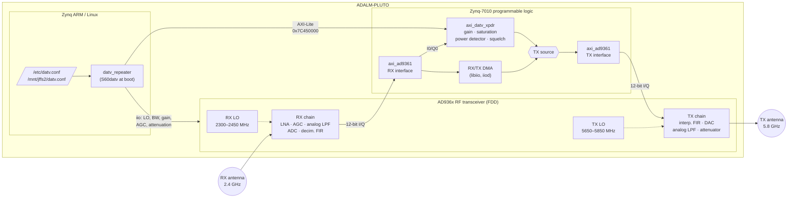

# yATOLYE DATV Repeater

A stand-alone DATV (digital amateur television) repeater built on the
[ADALM-PLUTO](https://wiki.analog.com/university/tools/pluto) SDR.

The repeater receives a DATV signal in the 2.4 GHz band and retransmits it,
unchanged, in the 5.8 GHz band. The receive and transmit frequencies, channel
bandwidth, receiver gain and AGC mode, and transmit power are all set from a
configuration file. The RX-to-TX relay runs entirely in the FPGA, so no
samples pass through the ARM CPU and latency stays at a few clock cycles.

This repository contains no firmware sources. It holds a set of patches for
the official [Analog Devices PlutoSDR firmware](https://github.com/analogdevicesinc/plutosdr-fw)
(release `v0.38`), plus a script that downloads that firmware and applies
the patches.

## yDATV-Repeater in action

[](https://youtu.be/p3D83u95pEU)

> **Note:** Transmitting at 5.65–5.85 GHz requires an amateur radio licence
> and is subject to your national band plan. The AD9363 on the Pluto is only
> specified up to 3.8 GHz. At 5.8 GHz it works in AD9364 mode, but the output
> power is low and varies between units. Use a suitable band-pass filter and
> power amplifier on the output.

---

## Architecture

### System overview



The frequency translation from 2.4 GHz to 5.8 GHz happens in the AD936x
itself. Its RX and TX local oscillators are separate synthesizers, so the
receiver can be tuned to the input channel and the transmitter to the output
channel at the same time (FDD mode). RX and TX share one baseband sample
clock. This lets the received I/Q samples be sent straight to the
transmitter without resampling or clock domain crossing.

### FPGA data path

```
                      axi_ad9361 (l_clk domain)
  ┌──────────────────────────────────────────────────────────────────────────┐
  │                                                                          │
  │ adc_data_i0/q0 ──┬─► rx_fir_decimator ─► cpack ─► RX DMA ─► libiio       │
  │ (12-bit, sign-   │                                                       │
  │  extended to 16) │   ┌──────────────── axi_datv_xpdr ─────────────────┐  │
  │                  │   │                                                │  │
  │                  └──►│ s0: capture ─► s1: x·gain (Q4.12) ─► s2: >>8,  │  │
  │                      │                    I²+Q²             saturate  │  │
  │                      │                     │                    │     │  │
  │                      │                     ▼                    ▼     │  │
  │                      │            IIR power avg (2^n) ─► squelch/mute │  │
  │                      │                     │              (hang time) │  │
  │                      │                     ▼                    │     │  │
  │                      │                 POWER reg                ▼     │  │
  │ TX DMA ─► upack ─► tx_fir_interpolator ───────────────► ┌──────────┐  │  │
  │                      │                                  │ enable ? │  │  │
  │                      │                                  └────┬─────┘  │  │
  │                      └───────────────────────────────────────┼────────┘  │
  │                                                              ▼           │
  │                       dac_data_i0/q0 (DAC data select = 2) ◄─┘           │
  └──────────────────────────────────────────────────────────────────────────┘
```

When the core is **disabled**, the TX path gets the normal DMA/interpolator
data, so the Pluto behaves like a stock unit. When **enabled**, the TX gets
the processed RX samples. Control registers cross from the AXI clock domain
to the data clock domain through `up_xfer_cntrl`, and status registers
cross back through `up_xfer_status`.

### Software

| Component | Location on target | Function |
| --- | --- | --- |
| `datv_repeater` | `/usr/sbin/datv_repeater` | Reads the configuration, validates it, programs the AD936x through libiio and the FPGA core through `/dev/mem`. Supports `start`, `stop`, `restart`, `status`. |
| `S60datv` | `/etc/init.d/S60datv` | Starts the repeater at boot. |
| `datv.conf` | `/etc/datv.conf` | Default configuration, part of the firmware image (read-only). |
| user configuration | `/mnt/jffs2/datv.conf` | Optional persistent override, survives reboots and firmware updates. |

---

## Technical specifications

| Parameter | Value |
| --- | --- |
| Hardware | ADALM-PLUTO Rev.C (Xilinx Zynq-7010 + AD9363), operated in AD9364 mode |
| Base firmware | plutosdr-fw `v0.38` (Linux 5.15, Buildroot 2022.02, Vivado 2022.2) |
| Duplex mode | FDD, 1 RX / 1 TX (RX1A in, TX1A out) |
| Input (RX) frequency | 2300 – 2450 MHz, default 2400 MHz |
| Output (TX) frequency | 5650 – 5850 MHz, default 5760 MHz |
| Channel bandwidth | 0.2 – 20 MHz, default 10 MHz (RX and TX analog filters) |
| Baseband sample rate | 2.5 – 61.44 MSPS; auto = 1.25 × bandwidth (12.5 MSPS for 10 MHz) |
| RX gain control | `manual`, `slow_attack`, `fast_attack`, `hybrid` |
| RX manual gain | −3 … 71 dB, 1 dB steps |
| TX power control | Attenuation 0 … 89.75 dB, 0.25 dB steps (0 dB = maximum output) |
| Digital gain (FPGA) | −40 … +24 dB, 0.1 dB resolution (unsigned Q4.12, 0x1000 = 0 dB) |
| Squelch threshold | −90 … 0 dBFS (0 dBFS = full-scale complex sinusoid) |
| Squelch hang time | 0 … 60 000 ms |
| Power detector | I²+Q² of the 12-bit samples, 1-pole IIR, time constant 2^n samples (n = 0 … 24) |
| FPGA core latency | 4 data clock cycles (RX sample to TX sample) |
| FPGA core address | `0x7C450000` (64 KiB AXI-Lite window) |
| Timing (full design) | All constraints met, WNS +1.164 ns, WHS +0.013 ns |
| Resources (full design) | 13 003 LUT (74 %), 22 673 FF (64 %), 76 DSP48 (95 %), 2 BRAM |

### FPGA core register map (`axi_datv_xpdr`)

| Offset | Name | Access | Description |
| --- | --- | --- | --- |
| `0x000` | VERSION | RO | Core version, `0x00010061` = 1.0.a |
| `0x004` | ID | RO | Instance ID |
| `0x008` | SCRATCH | RW | Scratch register |
| `0x00C` | MAGIC | RO | `0x44415456` ("DATV") |
| `0x040` | CONTROL | RW | bit 0: enable (TX fed from RX), bit 1: squelch enable, bit 2: force mute |
| `0x044` | GAIN | RW | [15:0] digital gain, unsigned Q4.12, `0x1000` = 0 dB (ADC full scale → DAC full scale) |
| `0x048` | SQ_THRESH | RW | [23:0] squelch open threshold, compared to POWER |
| `0x04C` | SQ_HANG | RW | [31:0] squelch hang time in samples |
| `0x050` | AVG_SHIFT | RW | [4:0] power averaging, time constant 2^n samples (max 24) |
| `0x080` | STATUS | RO | bit 0: enabled, bit 1: squelch open (TX active) |
| `0x084` | POWER | RO | [23:0] averaged I²+Q²; full-scale complex sinusoid = 4 194 304 |
| `0x088` | SAT_COUNT | RO | Number of saturated output samples (wraps) |

---

## Configuration

The repeater reads `/etc/datv.conf` first, then `/mnt/jffs2/datv.conf` if it
exists. Values in the second file take precedence. To customise:

```sh
ssh root@192.168.2.1                    # password: analog
cp /etc/datv.conf /mnt/jffs2/datv.conf
vi /mnt/jffs2/datv.conf
datv_repeater restart                   # apply without reboot
```

| Key | Default | Range | Description |
| --- | --- | --- | --- |
| `enable` | `1` | 0, 1 | 1 = relay RX to TX, 0 = TX muted |
| `rx_freq_mhz` | `2400` | 2300 – 2450 | Input centre frequency |
| `tx_freq_mhz` | `5760` | 5650 – 5850 | Output centre frequency |
| `bandwidth_mhz` | `10` | 0.2 – 20 | Channel bandwidth |
| `sample_rate_msps` | `0` | 0 – 61.44 | 0 = auto (1.25 × bandwidth, min 2.5) |
| `rx_gain_mode` | `slow_attack` | manual, slow_attack, fast_attack, hybrid | RX AGC mode |
| `rx_gain_db` | `40` | −3 – 71 | RX gain, `manual` mode only |
| `tx_attenuation_db` | `10` | 0 – 89.75 | TX attenuation, 0 = maximum power |
| `digital_gain_db` | `0` | −40 – 24 | FPGA gain between RX and TX |
| `squelch` | `0` | 0, 1 | Mute TX when no input signal |
| `squelch_dbfs` | `−40` | −90 – 0 | Squelch threshold |
| `squelch_hang_ms` | `500` | 0 – 60000 | Keep TX on after the signal drops |
| `power_avg_shift` | `10` | 0 – 24 | Power detector time constant 2^n samples |

The script checks every value before applying anything. If a value is out
of range, it stops with an error and the TX stays muted. While the device
is being reconfigured, the TX is muted and set to maximum attenuation.

### Status

```
# datv_repeater status
RX LO:        2399999998 Hz
TX LO:        5759999996 Hz
sample rate:  12500000 Hz
RX bandwidth: 10000000 Hz
RX gain:      slow_attack, 71.000000 dB
RX RSSI:      118.75 dB
TX gain:      -10.000000 dB
repeater:     enabled
TX output:    active
input power:  -36.6 dBFS
saturations:  0
```

### Notes on the squelch

When AGC is enabled, the level seen by the FPGA is normalised by the AGC,
so `squelch_dbfs` is a threshold relative to the AGC working point, not an
absolute input level. Short bursts from other users of the 2.4 GHz ISM band
(Wi-Fi, Bluetooth) can briefly push the average above the threshold and
open the squelch. Increase `power_avg_shift` and/or use manual RX gain to
make it more selective.

---

## Building

### Requirements

- Linux host (tested on Ubuntu 24.04)
- Xilinx Vivado / Vitis **2022.2** installed under `/opt/Xilinx`
- The usual Buildroot host packages (`build-essential`, `git`, `bc`,
  `cpio`, `rsync`, `unzip`, `wget`, `python3`, …), `dfu-util`, `sshpass`
- About 40 GB of free disk space

### Get the sources

```sh
git clone https://github.com/barisdinc/yATOLYE-DATV-Repeater.git
cd yATOLYE-DATV-Repeater
./setup.sh            # or ./setup.sh --shallow for a smaller download
```

`setup.sh`:

1. clones `analogdevicesinc/plutosdr-fw` at tag `v0.38` into `./plutosdr-fw`
2. checks out the `hdl`, `buildroot`, `linux` and `u-boot-xlnx` submodules
   and makes sure they are at the commits the patches are based on
3. creates a `yatolye-datv` branch in `hdl` and `buildroot` and applies the
   patches from `patches/` with `git am`

You can safely run the script again. It skips patches that are already
applied, and it refuses to touch a submodule that has local changes.

### Build

```sh
cd plutosdr-fw
SKIP_LEGAL=1 make build/pluto.dfu
```

The first build takes about an hour: toolchain, root filesystem, Linux and
the Vivado implementation.

> Pass `SKIP_LEGAL` (and any other option) as an **environment variable**,
> not as a `make` argument. Variables given on the `make` command line are
> passed on to the HDL build. The HDL build then puts the Vivado project in
> a separate sub-directory, and the top-level Makefile picks up the old
> bitstream instead.

### Load and test from RAM

This does not touch the flash. A power cycle brings back the previous
firmware.

```sh
ssh root@192.168.2.1 device_reboot ram
dfu-util -D build/pluto.dfu -a firmware.dfu
dfu-util -d 0456:b674 -a firmware.dfu -e
```

### Write to flash

```sh
ssh root@192.168.2.1 device_reboot sf
dfu-util -D build/pluto.dfu -a firmware.dfu
dfu-util -d 0456:b674 -a firmware.dfu -e
```

### AD9364 mode

Tuning the TX to 5.8 GHz requires the AD9364 frequency range. Enable it once
on the device:

```sh
fw_setenv attr_name compatible
fw_setenv attr_val ad9364
reboot
```

---

## Repository layout

```
.
├── README.md
├── setup.sh                     # clone plutosdr-fw v0.38 and apply the patches
└── patches
    ├── hdl
    │   ├── 0001-library-Add-axi_datv_xpdr-DATV-transponder-core.patch
    │   └── 0002-projects-pluto-Insert-axi_datv_xpdr-between-RX-and-T.patch
    └── buildroot
        ├── 0001-package-ad936x_ref_cal-libiio-Update-hashes-of-git-t.patch
        ├── 0002-configs-zynq_pluto-Rebrand-as-yATOLYE-DATV-Repeater-.patch
        ├── 0003-board-pluto-Replace-motd-with-the-yATOLYE-DATV-Repea.patch
        └── 0004-board-pluto-Add-DATV-repeater-control-script-and-con.patch
```

| Patch | Description |
| --- | --- |
| hdl 0001 | New `axi_datv_xpdr` IP core (gain, saturation, power detector, squelch) |
| hdl 0002 | Pluto block design: core inserted between the RX and TX paths at `0x7C450000` |
| buildroot 0001 | Updated hashes for the git-generated `ad936x_ref_cal` and `libiio` tarballs |
| buildroot 0002 | Hostname `atolye-datv-repeater`, login banner, `ffmpeg` and `lame` packages |
| buildroot 0003 | yATOLYE DATV Repeater login banner (`/etc/motd`) |
| buildroot 0004 | `datv_repeater` control script, `datv.conf` and `S60datv` init script |

## Known limitations

- The AD9363 is not specified above 3.8 GHz. Output power at 5.8 GHz is
  low and varies from unit to unit, so an external PA is required.
- TX power is set as attenuation, not as an absolute level in dBm. An
  absolute setting would need a per-unit calibration table.
- When the squelch mutes the output, the DAC sends zeros, but some TX LO
  leakage remains at the output frequency. Use `enable = 0` (maximum
  attenuation) to switch the transmitter off completely.
- The full design uses 95 % of the Zynq-7010 DSP slices, which leaves
  little room for more DSP processing in the FPGA.
